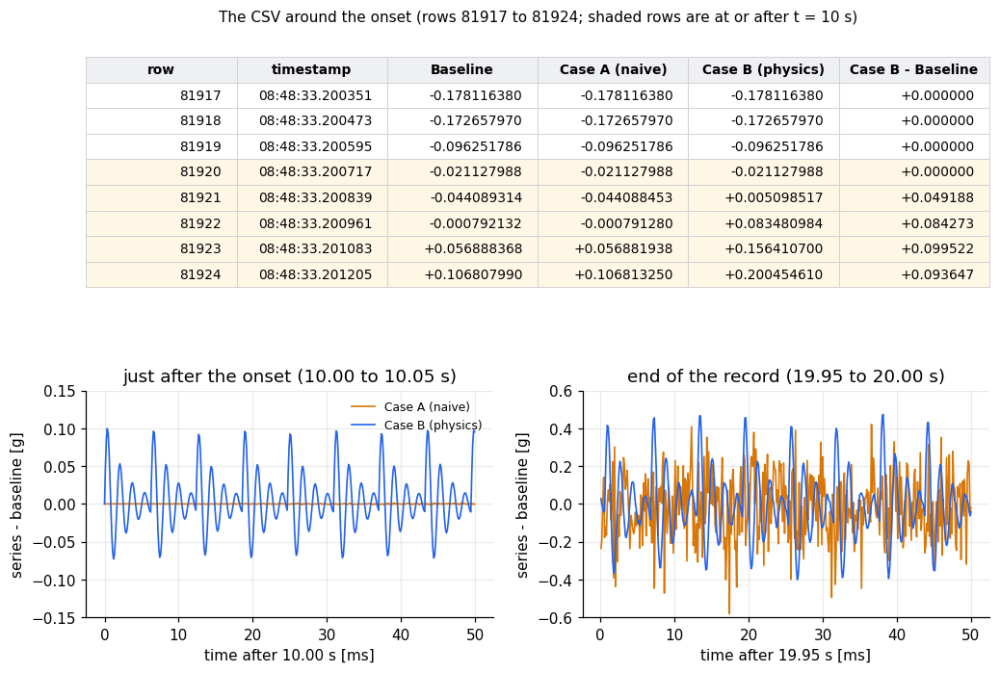
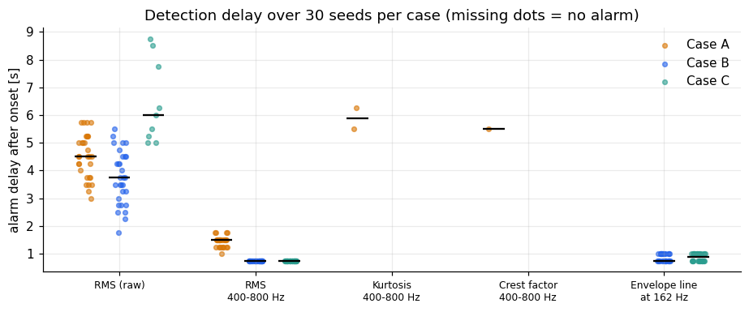

# Synthetic bearing-fault benchmarks

Synthetic vibration data for studying **bearing degradation**, generated with [tseriz](https://tseriz.com), plus the notebooks, configurations and QA tools needed to reproduce every number in the article **[ARTICLE_URL — add link]**.

The same healthy motor is degraded in three different ways, so a condition-monitoring method can be tested against known ground truth:

| Series | What changes between t = 10 s and t = 20 s |
|---|---|
| **Baseline** | Nothing (healthy motor, 1800 RPM, 30 Hz shaft) |
| **Case A: naive noise** | Pink noise x1.5 and white noise x9. No impacts |
| **Case B: inner-race fault** | Impacts at 162 Hz (BPFI = 5.4 x 30 Hz), each ringing a 600 Hz resonance (damping 0.1). Impact amplitude 0.1 g growing x5, pink noise x1.5 |
| **Case C: weak fault** | Case B with a constant 0.1 g impact amplitude (no growth) |

All series: single channel in g, 8192 Hz, 20 s (163,841 points), shaft lines at 30/60/90 Hz (0.5/0.2/0.1 g), pink noise 0.05 g and white noise 0.02 g. Within one seed the first 10 s are bit-identical across the cases, so any difference after 10 s is caused by the degradation alone.

[VIDEO_URL — add link]: screen recording of the Case A prompt entered in the tseriz AI agent.



## What the experiment shows

Thirty seeds per case (1001-1030), 90 series in total. Threshold = mean + 4 sd of each indicator over the healthy windows, alarm after 3 consecutive 1 s windows, delay measured from the onset to the end of the third window.

| Indicator | Case A detected / median delay | Case B | Case C |
|---|---|---|---|
| Overall RMS | 30/30, 4.5 s | 30/30, 3.75 s | 9/30 |
| RMS 400-800 Hz | 30/30, 1.5 s | 30/30, 0.75 s | 30/30, 0.75 s |
| Kurtosis 400-800 Hz | 2/30 | 0/30 | 0/30 |
| Envelope line at 162 Hz | **0/30** | **30/30, 0.75 s** | **30/30, 0.88 s** |

Noise-only degradation raises the overall and band levels but never produces the line at the fault rate. A real fault does, even when it is too weak for the overall RMS. See the article for the full discussion and the caveats (healthy windows are strongly correlated, thresholds are a convention, one simulator).



## Repository layout

```
configs/        tseriz configurations (JSON): baseline, case_a, case_b, case_c
prompts/        the plain-English prompts for the tseriz AI agent
notebooks/
  quickstart_samples.ipynb      runs on data/samples (no account needed)
  bearing_degradation.ipynb     full analysis behind the article
tools/
  generate_batch.py             generate the series through the tseriz API
  qa_bearing.py                 checks a generated CSV against the config that produced it
  bearing_lib.py                helper functions used by the quickstart
data/samples/   6 s excerpts (49,153 points) of real tseriz output
data/full/      full-length series (not tracked; generated locally)
figures/        figures from the notebook
results/        summary.json and mc_features.csv (indicators for the 90 series)
docs/           how the batch generation works
```

## Quick start (no account needed)

```bash
pip install -r requirements.txt
jupyter lab notebooks/quickstart_samples.ipynb
```

The samples are 6-second excerpts (t = 7 s to 13 s of the full series; the degradation starts at 3.0 s in the files) and fit within the 50,000-point limit of the Free plan. They show the signatures, but they contain only the first 30 % of the degradation ramp and 3 s of healthy data, so **they do not reproduce the numbers above**.

## Reproduce the article

You need full-length series (163,841 points each).

1. In your tseriz account create an API key and export it. Check that your plan allows 163,841 points per generation.
   ```bash
   export TSERIZ_API_KEY=...           # never commit this
   # export TSERIZ_BASE_URL=...        # only if you use a different host (default https://tseriz.com)
   ```
2. Generate the three seed-4242 series: `python tools/generate_batch.py --reference-set` (writes `data/full/baseline.csv`, `case_a.csv`, `case_b.csv`).
3. Generate the 90 Monte Carlo series: `python tools/generate_batch.py` (writes `data/full/mc/`). The script validates each config first, checks that seed 4242 reproduces the reference files, skips files that already exist, and runs `qa_bearing.py` on every series.
4. Run `notebooks/bearing_degradation.ipynb`.

Alternatively import `configs/*.json` in the tseriz web app (JSON import needs a paid plan), or paste the prompts from `prompts/prompts.md` into the AI agent. The JSON files are the authoritative definitions.

The same config and seed always give the same series, so your data match the article's. `tools/qa_bearing.py config.json data.csv` re-checks any file.

## Notes

- tseriz timestamps drift slightly (about 2.6 ppm slower than 1/8192 s), so the notebooks use the sample index as time axis.
- The excerpts and figures are real tseriz output; nothing is hand-edited.

## License

Code and configurations: MIT (see `LICENSE`). Sample data: same terms.
